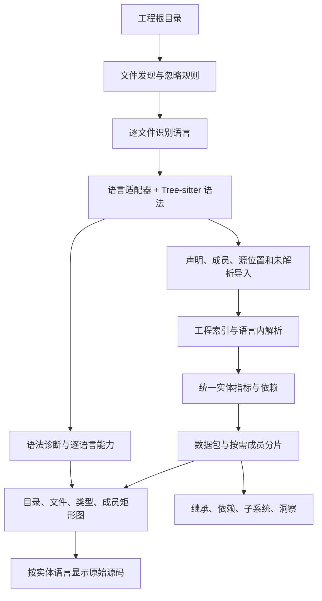

# Code Atlas 多语言架构

## 产品目标与本轮范围

分析单位是整个工程。语言属于文件、声明与关系，不属于应用实例；打开含 Python、C++、C 的仓库时，用户得到一张共享目录结构的工程地图。

本轮实现语法结构与静态依赖底座，优先 Python/C++，补充真实 STM32 项目需要的 C，并保留 Java。Lua 与 PowerShell 进入后续计划。精确调用图、编译器语义和跨语言绑定识别不属于当前已完成能力。

## 数据流与边界

前端不导入 Python/C++ 的 AST 节点定义。语法差异停在适配器；图形、指标和查询消费统一记录。源码高亮与数据提取共用语言注册表和语法版本。

| 模块 | 已实现职责 | 新增语言时的变化 |
| --- | --- | --- |
| `src/shared/languages.mjs` | 标识、扩展名、语法包、显示名称/颜色 | 注册语言和路径识别规则 |
| `tools/lib/parsers.mjs` | WASM 资源定位和解析器缓存 | 通常复用 |
| `tools/lib/adapters.mjs` | 语言到提取函数的注册、能力描述 | 注册新的结构提取函数 |
| `tools/lib/source-ast.mjs` | Python/C 家族的结构与文件依赖规则 | 独立语言可添加单独适配器，不扩张这里的条件链 |
| `tools/lib/java-ast.mjs` / `java-refs.mjs` | 兼容原 Java 提取与细粒度引用 | 保留为 Java 专用实现 |
| `tools/extract.mjs` | 扫描、工程索引、解析、指标、输出 | 共享管线；今后继续将语言内解析下沉适配器 |
| `src/domain` | 统一记录、索引与查询 | 仅在新增通用概念时变化 |
| `src/views` | 目录/文件布局、结构图、源码查看 | 新增语言本身无需新增一套图形视图 |

适配器当前返回 `{types, file, refs, sites, flow}`。`types` 包含模块及类型，`members` 包含函数/方法/字段；这是兼容已有数据包的过渡合同。`EntityRec` 是前端实体记录，`ClassRec` 作为兼容别名保留。

## 统一模型的演进

当前实现增加了文件模块种类、language 和显式 fqn，文件名与语言参与身份，避免不同文件/语言里的同名类互相覆盖。数值 id 只在一次提取的数据包内有效，不保证重建后稳定；旧书签跨重建的稳定定位尚未实现。

后续完整图模型应拆开以下概念，而不继续增加 Java 类字段：

| 实体 | 示例 | 所属关系 |
| --- | --- | --- |
| project / directory | 工程、`src/vision` | 工程与目录树 |
| file / module | `tracker.py`、`tracker.cpp` | 目录包含文件，语言模块可跨文件 |
| namespace | Python 包、C++ 命名空间 | 语义作用域，与物理路径独立 |
| type | class、struct、enum、interface | 文件定义类型，类型可嵌套 |
| callable | function、method、constructor | 顶层模块或类型拥有 |
| value | variable、field、constant | 作用域拥有 |

推荐的图节点合同：`id, kind, language, name, qualifiedName, parentId, sourceRange, metrics, attributes`。关系合同：`from, to?, kind, sourceRange, targetText, resolution, producer`。源位置必须带文件和范围；语言专有数据进入 attributes，而非污染所有节点。

此完整图合同是下一阶段设计，尚未替代本轮列式数据包。保留旧数据/视图兼容，先让两个不同语法家族真实跑通，再逐步迁移文件、命名空间、函数为独立可查询节点。

## 关系与可信度

必须分别表达 contains、imports/includes、inherits、type-reference、calls、reads/writes。import 和 include 不表示运行时调用；目录聚合边也不能冒充函数调用边。

当前 Python/C 家族支持字面导入/include 和有限的直接类型解析。Python 识别相对导入、import 别名及常见 src 布局；C 家族支持相对 include、根路径及唯一后缀。候选不唯一时不连接；未找到内部目标时也不按同名跨语言推断。

下一阶段保留 `resolved / ambiguous / unresolved / external` 状态及原始引用文本，并在 UI 允许查看来源。当前图只输出已解析的内部边，无法从边数推算总体解析覆盖率。不要将“没有边”解释为“没有依赖”。

跨语言互操作需要独立适配器读取 pybind11、ctypes/cffi、C ABI 声明或构建配置等明确证据。关系的生产者与证据应保留，动态关系与静态关系不能混为一谈。

## 能力驱动的界面

`meta.languageCapabilities` 按语言描述 structure、inheritance、fileDependencies、memberReferences；旧的汇总 capabilities 为兼容保留。混合工程中 Java 支持成员引用不意味着 Python/C++ 也支持。

- 矩形图沿目录 → 文件 → 类型/顶层代码展示；成员层按需加载。
- 语言筛选与语言着色属于工程地图；统计概览仍明确按整个工程汇总。
- 继承视图排除模块节点；脚本没有类时不强行制造类树。
- 源码查看器依据实体 language 选择语法；加载失败则显示转义后的纯文本。
- 总览显示能力说明及语法诊断数量，保留文件名供检查。
- Java 的 Lua 暴露能力属于专用扩展，不能作为新语言适配的必备字段。

当前界面仍有历史命名和 Java 专用说明，需要继续按实际使用逐步清理。成员级调用分析当前仅 Java 可用。

## Python 与 C++ 的深化路径

| 层次 | Python | C++ |
| --- | --- | --- |
| 语法结构（当前） | Tree-sitter；模块/类/函数与字面 import | Tree-sitter；类型、函数、声明和 include |
| 工程语义（后续） | 读取包根、导入路径、类型分析器结果 | 读取 compile_commands.json、宏、include 路径和编译单元 |
| 精确符号（后续） | 对接语言服务器/类型分析器，仍保留动态边界 | 对接 clangd/Clang，合并声明定义，解析重载与模板 |
| 互操作（后续） | Python 绑定与外部调用证据 | 导出符号与绑定声明证据 |

本轮 C++ 声明/定义保留不同源位置，不合并重载或跨文件实现；命名空间记录在限定名称内，未成为独立图节点。Python 实例属性、嵌套函数和运行时修改也尚未完整建模。STM32 厂商源码的宏/编译器扩展会产生部分语法诊断，属于语法层边界。

## 数据与运行约束

源码目录只读，提取不会运行目标工程代码。源码 URL mount 与真实目录分开解析；中文和空格文件名通过 URL 编码访问。数据输出使用独立目录，重复提取成功后删除旧成员/引用 JSON，避免换项目后引用串数据。

Git 仓库依赖 Git 自身处理忽略规则；普通目录使用固定排除表。目前开发更新仍做整树重提取，尚未做文件内容缓存或增量关系更新。单进程提取也不支持同时向同一输出目录写入多个工程。

当真实工程规模证明需要时，再加入按内容哈希的文件缓存、反向依赖失效和工作线程。不同构建配置的数据必须隔离，尤其是 C++ 宏条件下的不同编译单元。

## 新增语言的验收

1. 注册扩展名与语法资源，提供结构适配器和明确能力描述。
2. 对真实源码与小型回归例验证：声明、注释/字符串、Unicode、语法错误、同名、嵌套与模块函数。
3. 保证行数/字节归属、成员位置与内部关系一致；歧义不静默猜测。
4. 与现有语言放入同一工程验证布局、筛选、着色与源码高亮。
5. 只有结构提取与显示都通过，才在支持列表中声明支持；仅安装 grammar 不算完成适配。

下一批可按实际使用加入 Lua 与 PowerShell：前者重点是模块、table 与函数定义，后者重点是脚本、函数、命令及模块导入。复用统一模型，不套 Java 类语义。

## 参考

语法结构由 [Tree-sitter](https://github.com/tree-sitter/tree-sitter) 提供；首批适配基于官方 [Python grammar](https://github.com/tree-sitter/tree-sitter-python)、[C++ grammar](https://github.com/tree-sitter/tree-sitter-cpp)、[C grammar](https://github.com/tree-sitter/tree-sitter-c) 与原 [Java grammar](https://github.com/tree-sitter/tree-sitter-java)。
